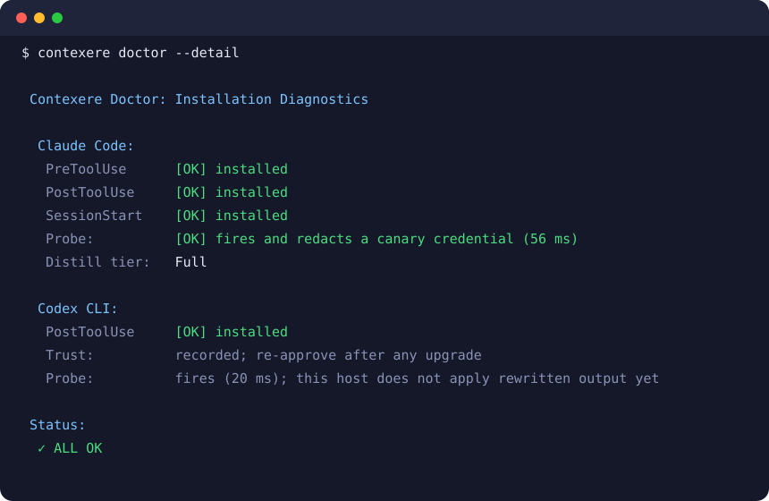

<div align="center">
  

<h1>Contexere</h1>
<p align="center">
    <em><b>The context and token layer for coding agents.</b> It shrinks noisy tool output, folds what an agent already read, and redacts credentials in the output it rewrites. Nothing is lost.</em>
</p>

[🇺🇸 English](README.md) | [🇯🇵 日本語](i18n/README-ja.md) | [🇨🇳 简体中文](i18n/README-zh.md) | [🇸🇦 العربية](i18n/README-ar.md) | [🇮🇩 Bahasa Indonesia](i18n/README-id.md) | [🇻🇳 Tiếng Việt](i18n/README-vi.md) | [🇰🇷 한국어](i18n/README-ko.md)

[](https://github.com/fajarhide/omni/actions/workflows/ci.yml)
[](https://github.com/fajarhide/omni/releases)
[](https://github.com/fajarhide/omni/blob/main/LICENSE)
</br></br>

```bash
brew install fajarhide/tap/contexere && contexere init
```

</br>

</div>

---

> OMNI is now **Contexere**, Latin for "to weave together" and the root of "context". The `omni` command keeps working, so existing installs need no change. Contexere is growing into the credential boundary for AI coding agents, so your agent can use your keys without ever seeing them; today it ships the context and token layer.

## Why

A coding agent reads everything a command prints: progress bars, layer hashes, a file it already read ten minutes ago. Every byte is billed and takes room the agent needs for the actual work.

Contexere takes out what the model does not need, before the model reads it. Nothing is deleted: whatever it removes stays on your machine, and one command brings it back.

## Features

- Reads a file the agent already read: sends one line with a handle instead of the file again.
- Runs a noisy build or test: keeps the result and the failures, drops the progress noise.
- Prints a token or password in output it rewrites: replaces it with `[REDACTED]` before the model sees it.
- Fails a command: passes it through as printed, so the real error reaches the agent. A credential printed by a failing command reaches the agent too.
- Reads JSON, YAML or CSV: leaves it byte for byte.
- `contexere doctor` checks that each agent's hooks fire and redact.

<table>
<tr>
<td align="center"><b>Without Contexere</b><br/><sub>the same 7.6 KB file, read twice</sub></td>
<td align="center"><b>With Contexere</b><br/><sub>the second read is 214 B, <b>97.2%</b> smaller</sub></td>
</tr>
<tr>
<td valign="top"></td>
<td valign="top"></td>
</tr>
</table>

It costs about 21 ms per command. Savings depend on what your agent does; run `contexere stats` for your own figure. Method and full numbers are on the [benchmarks page](https://omni.weekndlabs.com/docs/develop/benchmarks).

## Install

```bash
brew install fajarhide/tap/contexere
```

| Where | Command |
|---|---|
| macOS, Linux, WSL | `curl -fsSL omni.weekndlabs.com/install \| bash` |
| Windows (PowerShell) | `irm omni.weekndlabs.com/install.ps1 \| iex` |

Existing installs keep working under `omni`, which is the same program.

## Usage

```bash
contexere init      # pick your agents: Claude Code, Codex, Cursor, VS Code and more
contexere doctor    # check it is wired, or `contexere doctor --fix`
contexere stats     # what Contexere saved on your own history
```



After `init`, the hooks run on their own. There is nothing to prefix.

## Supported agents

| Tier | Agents |
|---|---|
| **Full** (rewrites tool output before the model reads it) | Claude Code, Codex CLI, Gemini CLI, OpenClaw, Hermes, Pi, Aider (via `cmd \| contexere`) |
| **Handoff-first** (shortens what the agent runs through `omni_run`) | Cursor, Windsurf |
| **MCP-only** (memory and recall, plus `omni_run`) | Cline, Roo, OpenCode, VS Code, Zed, Copilot, Antigravity |

Codex runs only hooks it trusts: after `contexere init --codex`, start `codex` once and approve them ([#359](https://github.com/fajarhide/omni/issues/359)).

## Documentation

- [Manual](https://omni.weekndlabs.com/docs)
- [CHANGELOG.md](CHANGELOG.md)

## Contributing

Issues and pull requests are welcome. Start with [CONTRIBUTING.md](CONTRIBUTING.md).

## Security

Do not open a public issue. [Report privately](https://github.com/fajarhide/omni/security/advisories/new); details in [SECURITY.md](SECURITY.md).

## License

[Apache License 2.0](LICENSE).
