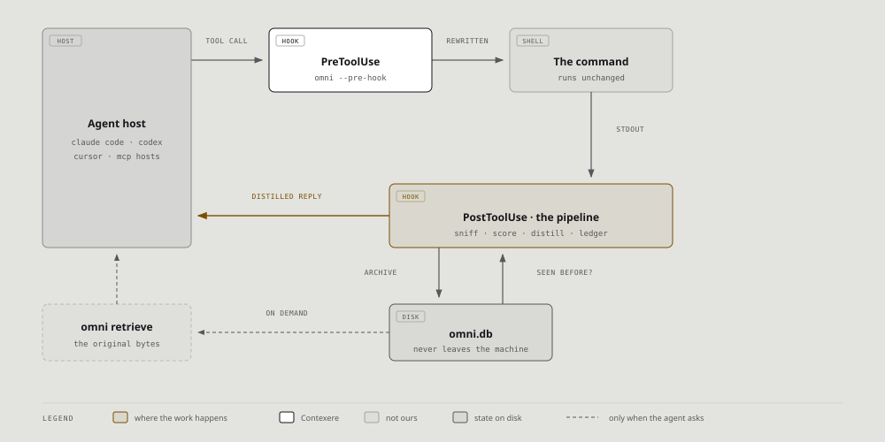

<div align="center">
  

<h1>OMNI</h1>
<p align="center">
    <em><b>OMNI はコーディングエージェントの読む量を減らします。</b>コマンド出力からノイズを取り除き、エージェントがすでに見たファイルを再送しません。トークンは減り、失われるものはありません。</em>
</p>

[🇺🇸 English](../README.md) | [🇯🇵 日本語](README-ja.md) | [🇨🇳 简体中文](README-zh.md) | [🇸🇦 العربية](README-ar.md) | [🇮🇩 Bahasa Indonesia](README-id.md) | [🇻🇳 Tiếng Việt](README-vi.md) | [🇰🇷 한국어](README-ko.md)

[](https://github.com/fajarhide/omni/actions/workflows/ci.yml)
[](https://github.com/fajarhide/omni/releases)
  [](https://www.rust-lang.org/)
  [](https://modelcontextprotocol.io/)
  [](https://discord.gg/zHTuvZhF2M)
  [](https://github.com/fajarhide/omni/blob/main/LICENSE)
  [](https://hits.sh/github.com/fajarhide/omni/)
  [](https://www.greptile.com/?utm_source=oss_badge&utm_medium=readme&utm_campaign=greptile_for_open_source)
</br></br>

```bash
brew install fajarhide/tap/omni && omni init
```

</br>

</div>

---

## なぜ必要か

コーディングエージェントは、コマンドが出力するものをすべて読みます。プログレスバー、
レイヤーハッシュ、10 分前にすでに読んだファイル。そのバイトはすべて課金され、しかも
エージェントが本来の作業に使うべき余地を奪います。長いセッションは埋まり、遅くなり、
必要以上にコストがかかります。

OMNI は、モデルが読む前に、モデルに不要なものを取り除きます。何も削除されません。
取り除いたものはあなたのマシンに残り、コマンド一つで元に戻せます。

## 何をするのか

| エージェントが... | OMNI は... |
|---|---|
| すでに読んだファイルをまた読む | ファイルを再送せず、ハンドル付きの 1 行を送る |
| ノイズの多いビルドやテストを実行する | 結果と失敗は残し、進捗のノイズを落とす |
| `git log` や `git status` を実行する | すべてのコミットを残し、status は要約する |
| トークンやパスワードを出力する | モデルが見る前に `[REDACTED]` に置き換える |
| 失敗するコマンドを実行する | そのまま通すので、本当のエラーがエージェントに届く。中のシークレットも含めて |
| JSON、YAML、CSV を読む | バイト単位でそのまま通すので、後段でもパースできる |

<table>
<tr>
<td align="center"><b>OMNI なし</b><br/><sub>同じ 7.6 KB のファイルを 2 回読む</sub></td>
<td align="center"><b>OMNI あり</b><br/><sub>2 回目の読み取りは 214 B、<b>97.2%</b> 小さい</sub></td>
</tr>
<tr>
<td valign="top"></td>
<td valign="top"></td>
</tr>
</table>

## 仕組み



OMNI は、エージェントホストがすでに行っているツール呼び出しの前後に置かれた 2 つの
Hook です。プロキシもアカウントも不要で、データベースがあなたのマシンの外に出ることは
ありません。

- **Distillers** は `cargo`、`docker`、`git` などのツールが出すノイズの多い出力を短くします。
- **ledger** は、エージェントがすでに保持している行をマーカーとハンドルに置き換えます。
- **RewindStore** は取り除いたものをすべて保管するので、`omni retrieve <handle>` でバイト単位で
  そのまま取り戻せます。

## インストール

```bash
brew install fajarhide/tap/omni
omni init      # エージェントを選択: Claude Code, Codex, Cursor, VS Code ほか
omni doctor    # 設定を確認。または `omni doctor --fix`
```

ほかの方法:

| 環境 | コマンド |
|---|---|
| macOS, Linux, WSL | `curl -fsSL omni.weekndlabs.com/install \| bash` |
| Windows (PowerShell) | `irm omni.weekndlabs.com/install.ps1 \| iex` |
| Claude Code の中 | `/plugin marketplace add fajarhide/omni` のあとに `/plugin install omni@omni` |
| スキルを読むエージェントなら何でも | `npx skills add fajarhide/skills --skill omni` |

最後の 2 つは、バイナリの入手方法と OMNI のマーカーの読み方をエージェントに伝える
スキルをインストールします。

あとはいつも通り作業するだけです。コマンドの前に何かを付ける必要はありません。

## よく使うコマンド

| コマンド | 内容 |
|---|---|
| `omni stats` | あなた自身の履歴で OMNI が節約した量 |
| `omni retrieve <handle>` | マーカーの元になった出力そのもの |
| `omni doctor` | どのエージェントが設定済みか、各エージェントで OMNI に何ができるか |
| `omni dashboard` | 同じ数字をローカルの読み取り専用ウェブページで表示 |

## 対応エージェント

| ティア | エージェント | OMNI にできること |
|---|---|---|
| **Full** | Claude Code, Codex CLI, Gemini CLI, OpenClaw, Hermes, Pi, Aider (`cmd \| omni`) | モデルが読む前にツール出力を書き換える |
| **Handoff-first** | Cursor, Windsurf | `omni_run` を通してエージェントが実行するものを短くする |
| **MCP-only** | Cline, Roo, OpenCode, VS Code, Zed, Copilot, Antigravity | メモリとリコール、加えて `omni_run` |

Codex は信頼したフックしか実行しません。`omni init --codex` のあとに `codex` を一度起動し、
承認してください ([#359](https://github.com/fajarhide/omni/issues/359))。

## 保証

- **何も失われません。** 取り除いたものはすべてローカルに保管され、バイト単位でそのまま
  戻ります ([#388](https://github.com/fajarhide/omni/issues/388))。
- **結果を捏造しません。** OMNI が出力をパースできないときは、でっち上げの
  `passed` ではなく生の出力が返ります ([#143](https://github.com/fajarhide/omni/issues/143))。
- **失敗はそのまま届きます。** 失敗したコマンドは出力されたまま通ります
  ([#120](https://github.com/fajarhide/omni/issues/120))。
- **構造化データには触れません。** JSON、YAML、NDJSON、CSV はバイト単位でそのまま戻ります。

## 数字

OMNI がどれだけ節約するかは、エージェントが何をするかで決まります。2 回読んだファイルでは 97.2% です。
10 個の公開リポジトリにまたがる 40 件の [SWE-bench](https://www.swebench.com/) タスク、つまりほとんどがソースの読み取りでは
30.3% です。実際のコマンドを中心とした、シェル作業の多い 1 週間では 2.4% で、そのコーパスでは OMNI は
headroom と lean-ctx に負けています。ご自身の数字は `omni stats` で確認してください。

コストは 1 コマンドあたり約 21 ms で、履歴が増えるほど大きくなります。Claude Code の 20 組のペアセッションでは、
OMNI を使ったセッションの請求額は 11.0% 低くなりました。

詳細な表、測定方法、直接比較は [ベンチマークページ](https://omni.weekndlabs.com/docs/develop/benchmarks) にあります。

## FAQ

**プロンプトキャッシュは壊れますか?** いいえ。OMNI が書き換えるのは最新のツール結果だけで、
それより前はバイト単位でそのまま残ります。

**OMNI はどれくらいの期間保持しますか?** プロジェクト知識は削除するまで。取り除いた出力、
セッション、ledger は 30 日間で、それより古いハンドルは解決できません。`omni
reset` はすべてを消去します。

**独自のフィルタを追加できますか?** できません。フィルタ層は、ほとんど何も節約できなかったため 0.7.4 で廃止されました。
あるツールに対応が必要なら issue を立ててください。バイナリに組み込まれて出荷されます。

## もっと知る

- [マニュアル](https://omni.weekndlabs.com/docs): 各部分の仕組みを詳しく
- [コントリビュート](../CONTRIBUTING.md): パイプライン、コーディング規約、CI ゲート
- [CHANGELOG.md](../CHANGELOG.md) と [SECURITY.md](../SECURITY.md)
- [Discord](https://discord.gg/zHTuvZhF2M): 質問、または OMNI が誤った動作をした報告

エージェント型 AI の時代のための情熱プロジェクトです。貢献を歓迎します。
[Apache License 2.0](../LICENSE)。

<p align="center">
  <a href="https://star-history.dera.page/#fajarhide/omni&Date">
    <picture>
      <source media="(prefers-color-scheme: dark)" srcset="https://star-history.dera.page/svg?repos=fajarhide/omni&type=Date&theme=dark" />
      <source media="(prefers-color-scheme: light)" srcset="https://star-history.dera.page/svg?repos=fajarhide/omni&type=Date" />
      
    </picture>
  </a>
</p>

<p align="center">Built with care by <a href="https://github.com/fajarhide">Fajar Hidayat</a></p>
