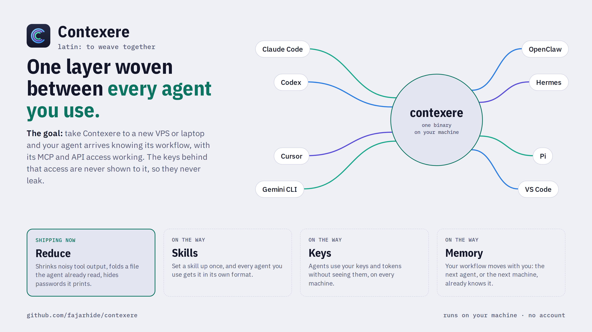
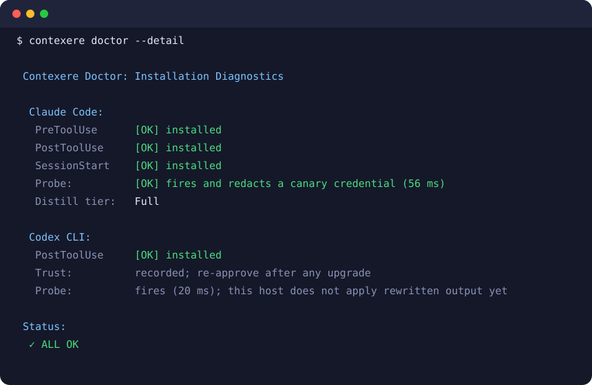

<div align="center">
  

<h1>Contexere</h1>
<p align="center">
    <em><b>어떤 환경에서도 똑같은 AI 에이전트: 워크플로, 도구, 접근 권한이 함께 오고, 키는 에이전트에게 닿지 않습니다.</b> 이것이 지향하는 모습입니다. 현재는 시끄러운 도구 출력을 줄이고, 에이전트가 이미 읽은 내용을 접고, 다시 쓴 출력 안의 자격 증명을 마스킹합니다. 잃어버리는 것은 없습니다.</em>
</p>

[🇺🇸 English](../README.md) | [🇯🇵 日本語](README-ja.md) | [🇨🇳 简体中文](README-zh.md) | [🇸🇦 العربية](README-ar.md) | [🇮🇩 Bahasa Indonesia](README-id.md) | [🇻🇳 Tiếng Việt](README-vi.md) | [🇰🇷 한국어](README-ko.md)

[](https://github.com/fajarhide/contexere/actions/workflows/ci.yml)
[](https://github.com/fajarhide/contexere/releases)
[](https://github.com/fajarhide/contexere/blob/main/LICENSE)
</br></br>

<picture>
  <source media="(prefers-color-scheme: dark)" srcset="../media/contexere-poster-dark.png" />
  
</picture>
</div>

---

> OMNI는 이제 **Contexere**입니다. 라틴어로 "함께 엮다"라는 뜻이며 "context"의 어원입니다. `omni` 명령은 0.9.0까지 동작합니다. 사용하는 에이전트마다 `contexere init --<host>`를 실행하면 기존 설치가 옮겨집니다. 0.8.6부터 데이터는 자동으로 `~/.contexere`로 옮겨집니다.

## 앞으로의 방향

목표는 이렇습니다. Contexere를 새 VPS나 노트북으로 가져가면, 에이전트는 자기 워크플로를 이미 알고 있고 MCP 서버와 API 접근도 그대로 동작합니다. 그 접근을 가능하게 하는 키는 에이전트에게 한 번도 보여 주지 않으므로 유출되지 않습니다. 그 주변에는 한 번만 설정하면 모든 에이전트가 쓰는 스킬과, 에이전트와 머신을 넘어 이어지는 메모리가 있습니다. 이 부분은 개발 중입니다. 지금 제공하는 것은 그 첫 부분, 아래에서 설명하는 컨텍스트와 토큰 레이어입니다.

## 왜 필요한가

코딩 에이전트는 명령이 출력하는 모든 것을 읽습니다. 진행 표시줄, 레이어 해시, 10분 전에 이미 읽은 파일. 그 바이트는 모두 과금되고, 에이전트가 실제 작업에 써야 할 공간을 차지합니다.

Contexere는 모델이 읽기 전에 모델에 필요 없는 것을 걷어냅니다. 아무것도 삭제되지 않습니다. 걷어낸 내용은 당신의 머신에 남고, 명령 하나로 되돌릴 수 있습니다.

## 기능

- 에이전트가 이미 읽은 파일을 다시 읽을 때: 파일 대신 핸들이 담긴 한 줄을 보냅니다.
- 시끄러운 빌드나 테스트를 실행할 때: 결과와 실패는 남기고 진행 노이즈는 버립니다.
- 다시 쓰는 출력에 토큰이나 비밀번호가 있을 때: 모델이 보기 전에 `[REDACTED]`로 바꿉니다.
- 명령이 실패할 때: 출력된 그대로 전달하므로 실제 오류가 에이전트에게 닿습니다. 실패한 명령이 출력한 자격 증명도 에이전트에게 그대로 닿습니다.
- JSON, YAML, CSV를 읽을 때: 바이트 단위로 그대로 둡니다.
- `contexere doctor`는 각 에이전트의 Hook이 동작하고 마스킹하는지 확인합니다.

비용은 명령당 약 21 ms입니다. 절감량은 에이전트가 하는 일에 따라 달라집니다. 내 수치는 `contexere stats`로 확인하세요. 방법과 전체 수치는 [벤치마크 페이지](https://omni.weekndlabs.com/docs/develop/benchmarks)에 있습니다.

## 설치

```bash
brew install fajarhide/tap/contexere
```

| 환경 | 명령 |
|---|---|
| macOS, Linux, WSL | `curl -fsSL omni.weekndlabs.com/install \| bash` |
| Windows (PowerShell) | `irm omni.weekndlabs.com/install.ps1 \| iex` |

기존 설치는 0.9.0까지 `omni`라는 이름으로 동작합니다. 같은 프로그램입니다. 에이전트마다 `contexere init --<host>`를 실행하면 옮겨집니다.

Claude Code 안에서 `/plugin marketplace add fajarhide/contexere` 다음에 `/plugin install contexere@omni`를 실행하면, 설치와 점검을 대신해 주는 스킬이 추가됩니다.

## 사용법

```bash
contexere init      # 에이전트 선택: Claude Code, Codex, Cursor, VS Code 등
contexere doctor    # 연결 상태 확인, 또는 `contexere doctor --fix`
contexere stats     # 내 기록에서 Contexere가 절감한 양
```



`init` 이후에는 Hook이 알아서 동작합니다. 명령 앞에 아무것도 붙일 필요가 없습니다.

## 지원 에이전트

| 티어 | 에이전트 |
|---|---|
| **Full** (모델이 읽기 전에 도구 출력을 다시 씀) | Claude Code, Codex CLI, Gemini CLI, OpenClaw, Hermes, Pi, Aider (`cmd \| contexere` 사용) |
| **Handoff-first** (`contexere_run`을 통해 에이전트가 실행하는 것을 줄임) | Cursor, Windsurf |
| **MCP-only** (메모리와 리콜, 그리고 `contexere_run`) | Cline, Roo, OpenCode, VS Code, Zed, Copilot, Antigravity |

Codex는 신뢰하는 hook만 실행합니다. `contexere init --codex` 후 `codex`를 한 번 실행해 승인하세요 ([#359](https://github.com/fajarhide/contexere/issues/359)).

## 문서

- [매뉴얼](https://omni.weekndlabs.com/docs)
- [CHANGELOG.md](../CHANGELOG.md)

## 기여

Issue와 Pull Request를 환영합니다. [CONTRIBUTING.md](../CONTRIBUTING.md)부터 읽어 주세요.

## 보안

공개 Issue를 열지 마세요. [비공개로 제보](https://github.com/fajarhide/contexere/security/advisories/new)해 주세요. 자세한 내용은 [SECURITY.md](../SECURITY.md)에 있습니다.

## 라이선스

[Apache License 2.0](../LICENSE).
